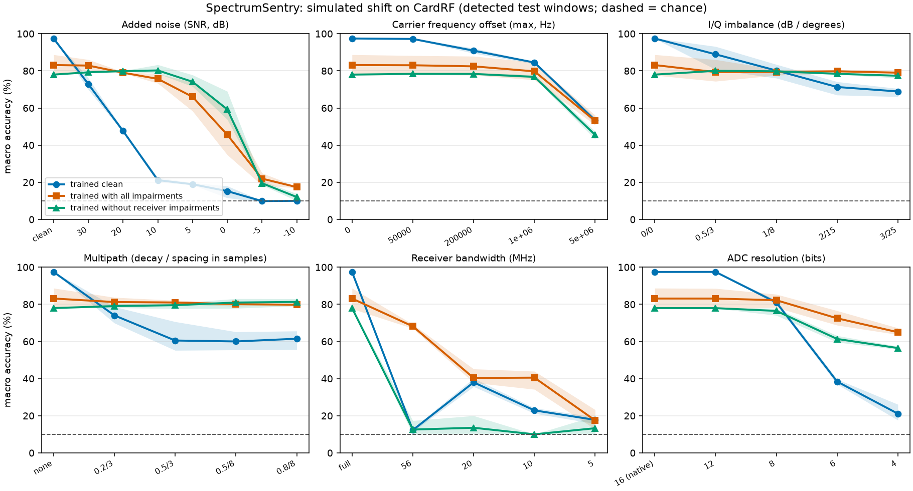

# Results so far

All numbers are on CardRF: 10 consumer drones, one anechoic chamber, one receiver, 1 s (2.4 GHz) or 0.5 s (5.8 GHz) per recording. A model sees one 65,536-sample window (0.55 ms at 120 MS/s) as a 64 x 64 spectrogram. Three seeds change only the training sample and initialisation, not the data, so the spread between seeds is **not** an error bar: windows from one recording are strongly correlated, and real uncertainty is larger than the seed spread suggests. Treat differences of a few points as unestablished.

## 1. Closed-set baseline (`scripts/run_closed_set.py`)

| Test | Accuracy (mean of 3 seeds) |
| --- | --- |
| Validation blocks (65-75% of each recording) | 78.6% |
| **Test blocks** (80-100% of each recording, 1,140 windows) | **77.2%** (77.3, 77.0, 77.3) |
| **Cross-recording**: train on part 1, test on part 2, four two-file drones | **68.1%** (67.1, 67.1, 70.0) |

Cross-recording, per held-out file: DJI Phantom 4 Pro Plus 5G 85.0%, DJI Matrice 210 5G 80.5%, DJI Inspire 2 5G 67.8%, Yuneec Typhoon H 2G 38.9%. The two parts of a recording are not consecutive stretches of one session, so this is the nearest the dataset gets to a new recording. It still comes from the same chamber and receiver.

The task is not trivial. I also ran the leaky contrast (`scripts/run_leaky.py`): shuffling all windows 80/20 regardless of time gives **76.3%** (77.5, 75.8, 75.7), no higher than the time-block split. So here, unlike the bearing data in the sibling project, window leakage is **not** inflating the score: 0.55 ms windows are not near-duplicates of their neighbours in a way this CNN exploits, and the error is dominated by something else (section 2). The time-block split was a sound precaution but did not change the answer on this dataset.

## 2. Where the errors are (`scripts/diagnose_windows.py`, `scripts/run_gated.py`)

Per-drone accuracy ranges from 59% (Typhoon H) to 98% (Phantom 4). The cause is mostly **empty windows**: frequency-hopping links are silent most of the time, so a 0.55 ms window often holds only noise. With an energy detector (a window passes if at least 30% of its 256-sample frames are 6 dB above the recording's own noise floor; both numbers fixed before looking at results):

| Drone | Windows passing the detector | Accuracy on detected windows (model trained on all windows) | (model trained only on detected windows) |
| --- | --- | --- | --- |
| DJI Phantom 4 | 88% | 100% | 100% |
| DJI Mavic Pro | 95% | 94.7% | 98.4% |
| DJI Matrice 100 | 89% | 98.8% | 97.2% |
| DJI Matrice 210 | 87% | 88.8% | 94.1% |
| DJI Inspire 2 | 88% | 82.6% | 86.6% |
| DJI Phantom 4 Pro Plus | 88% | 84.5% | 86.9% |
| DJI Mavic Mini | 54% | 100% | 100% |
| Parrot Disco | 13% | 100% | 100% |
| Parrot Mambo | 10% | 75% | 100% |
| Yuneec Typhoon H | 14% | 99.3% | 100% |

(Mean of 3 seeds. For the three drones with a 10-14% pass rate, only a few dozen test windows are detected, so their 100% means "few windows, all right", not a precise rate.)

Overall, 61.7% of test windows pass the gate (4,026 of 6,527). On those, the ungated model scores **89.6%** and a model trained only on detected windows **92.8%**. As a share of *all* test windows, "detected and correct" is 55.3% for the ungated model and 57.2% for the gated one.

What this says:

- **The 77% headline mostly measures how often a window contains a burst.** When a burst is present, classification is 93% or better for 7 of the 10 drones, and 100% for the sparse hoppers that are caught.
- **The real weaknesses are two.** (1) Detection coverage for sparse hoppers (Parrot Disco and Mambo, Yuneec Typhoon H): a fixed 0.55 ms window catches a burst only 10-14% of the time, so a deployed system would have to accumulate or use longer windows. (2) Confusion between DJI siblings: Inspire 2, Phantom 4 Pro Plus and Matrice 210 stay at 83-94% even on busy windows. I have not yet looked at a confusion matrix, so I do not know which pairs are confused or why.
- **Gated training helps a little and consistently** (about 3 points on detected windows, same sign in all three seeds), but it is one dataset and one run per seed.
- **The noise floor used by the gate comes from the whole recording.** A live receiver would estimate it from past samples only. Not tested.

## 3. Simulated shift (`scripts/run_shift.py`, figure: `scripts/make_figure.py`)

Setup: models trained only on detected windows (1,200 steps, 3 seeds); tested on the 939 detected windows of the held-out time blocks, with one impairment swept at a time. Metric is **macro accuracy** (mean per-drone recall), because the sparse hoppers contribute very few detected windows (13 each for Parrot Disco and Mambo, 35 for Typhoon H), so their share of the average is noisy. Chance is 10%. Every impairment is a *simulation* applied to chamber recordings; none is a field capture. The stated SNR is window mean power over noise power, which counts the recording's own noise floor as signal and averages over the silent gaps of hopping links, so the in-burst SNR is higher than stated.

| Condition | Trained clean | Trained with all impairments | Trained without receiver impairments |
| --- | --- | --- | --- |
| No impairment | **97.4%** | 83.1% | 78.0% |
| SNR 30 dB | 72.9% | 82.8% | 79.2% |
| SNR 20 dB | 47.6% | 79.0% | 79.9% |
| SNR 10 dB | 21.1% | 75.7% | 80.2% |
| SNR 0 dB | 15.2% | 45.6% | 59.2% |
| CFO up to 1 MHz | 84.5% | 79.7% | 76.8% |
| CFO up to 5 MHz | 53.4% | 53.1% | 45.5% |
| I/Q imbalance 2 dB / 15 deg | 71.3% | 79.8% | 78.4% |
| Multipath, decay 0.5, 24 ns spacing | 60.5% | 81.0% | 79.5% |
| Receiver bandwidth 56 MHz | 12.3% | 68.1% | 12.6% |
| Receiver bandwidth 20 MHz | 38.0% | 40.3% | 13.5% |
| ADC 8 bits | 81.0% | 82.2% | 76.5% |
| ADC 6 bits | 38.4% | 72.5% | 61.3% |

(Means over 3 seeds; the full tables are in `results/shift.json`.)

What this says:

- **The clean-trained model is very fragile.** It scores 97% on the unimpaired detected windows and drops to 73% with noise at a nominal 30 dB, 48% at 20 dB and 21% at 10 dB. Multipath alone takes it to about 60%, a narrower receiver to chance, and 6-bit sampling to 38%. Carrier frequency offsets up to 1 MHz cost little (84%), and 12-bit sampling nothing. The collapse at 30 dB suggests the model leans on the chamber's very clean noise floor, but I have not tested that explanation.
- **Training on the impairments recovers most of it, at a price.** With noise from -5 to 30 dB, offsets, imbalance, multipath, narrower receivers and fewer bits in training, accuracy stays around 80% for 10 dB noise, multipath and imbalance. The price is clean accuracy: 83% against 97% (and a wide spread across seeds, 78-89%). Whether a better recipe (more steps, a schedule from easy to hard) closes that gap is untested.
- **Augmentation generalises only partly to impairments it never saw.** The model trained without bandwidth limiting or re-quantisation (third column) is as good as the full-augmentation model on noise, offset, imbalance and multipath, which it did see, but stays at chance when the receiver is narrowed to 56 MHz (12.6%) and recovers only part of the way for 6-bit sampling (61% against 72.5% with it in training and 38% without any augmentation). So training on noise and channel effects did not protect against the receiver changing.
- **A narrower receiver is the most damaging case, and it is not a nuisance to be augmented away.** The hopping drones spread their bursts across the full capture, so a 56 MHz or narrower receiver does not see most of them. Even with that in training, 20 MHz gives only 40%. The clean model's accuracy is not monotonic in bandwidth (12% at 56 MHz, 38% at 20 MHz, 23% at 10 MHz); I do not know why and the windows involved are few.
- **All of this is in-family.** The augmentation and the test impairments come from the same simulator, with overlapping parameter ranges, so the recovery numbers are optimistic about real channels. The unseen-impairment column is the only out-of-family check, and it is weak evidence in the unflattering direction.

## Not done yet

Longer windows or burst-level classification for the sparse hoppers; a confusion matrix; an easy-to-hard augmentation schedule and tests of why the clean model is so sensitive to noise; open-set detection; the DroneRF dataset (verified and being converted); any real-time or on-device measurement.
