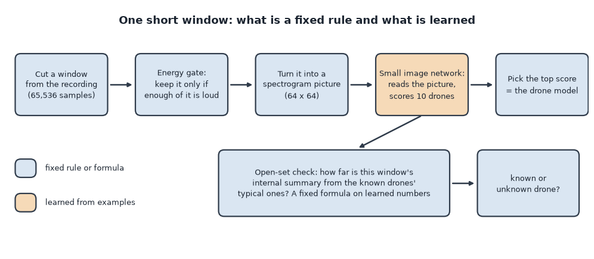
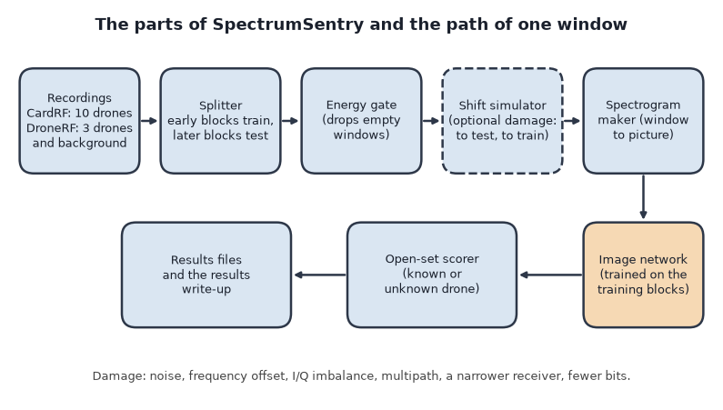
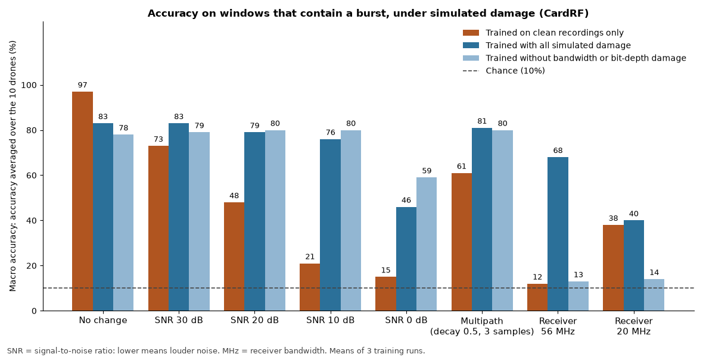

# SpectrumSentry

*A small program that listens to recordings of drone radio links and names the drone model, then measures how badly it fails when the radio conditions change.*

Status: an early, measured research prototype, last changed in October 2026. Code: https://github.com/PCSchmidt/spectrumsentry (public, MIT (Massachusetts Institute of Technology) licence, a permissive open-source licence). It only reads recordings. It never transmits and has never been connected to a live radio.

Every drone talks to its controller over radio, and the signal differs a little between models. SpectrumSentry cuts a recording into *windows*, very short slices a fraction of a millisecond long. Many drones transmit in *bursts*, brief flashes of signal with silence in between, so many windows hold no burst at all. Each window becomes a picture of which frequencies were active over time (a *spectrogram*), and a small neural network, software that learned a pattern from labelled examples instead of being given rules, names which of ten drone models produced it.

Here is what is fixed and what is learned. A calculator is deterministic: the same input always gives the same output. A weather forecast is probabilistic: a best guess that can be wrong. This project is mostly calculator with one forecaster inside. Cutting windows, checking whether a window holds a burst, making the picture, adding simulated damage and scoring "known or unknown" are fixed rules or formulas. The drone name comes from one learned model, a small image network trained from scratch. Its confidence is not checked against reality, and there is no language model anywhere. Chance enters through random training samples, so each number averages three training runs, each with its own *seed* (a number that fixes the random generator's starting point).

The other half of the project asks the more useful question: how fast does the answer fall apart when the recording is noisier, the receiver listens to a narrower band of frequencies (its *bandwidth*), or the data comes from somewhere else? The headline numbers, each with its caveat. This is a *closed-set* test, meaning every drone it is asked about was in training. On recordings from one lab (10 drones, one receiver, one room), the network names the drone correctly for 77% of test windows; guessing would give 10%. Most misses are empty windows; on windows that hold a burst it reaches about 93% (for a network trained only on such windows). Simulated noise changes the picture sharply. At an SNR (signal-to-noise ratio, how loud the signal is next to the noise) of 10 dB (dB, decibels, the scale; lower means louder noise), a network trained on clean recordings falls from 97% to 21%. Training on damaged copies recovers most of the loss for noise, but only part of it for a narrower receiver. Everything comes from one chamber, so differences of a few points are not established. AI coding agents wrote almost all of the code, and I directed the scope, plan, architecture and preferences.

If you have ten minutes, read this opening, then the chapters on what it does, the results, and the one for recruiters and interviewers.

## What problem this solves

A drone classifier trained and tested on recordings from the same room can score well and still be useless outdoors. Imagine a team that picks up an unfamiliar radio signal near a site and wants to know whether it is a drone type they track. A classifier built on clean laboratory recordings may have learned the lab's quiet background instead of the drone.

SpectrumSentry does not try to fix that. It tries to measure it on public data so the failure has numbers attached. The repository states its goal as a set of measurements: accuracy when whole stretches of time, and where possible whole recordings, are held out of training; accuracy under six simulated changes; and whether the model can flag an unknown drone. The data is public and unclassified, with no employer data. Drone radio is a field that interests me.

It deliberately does not transmit, jam or spoof (the design notes say doing so without a licence is illegal in most places), process live radio, or claim field accuracy. The simulated damage is a crude stand-in for real conditions, and the notes say so. A skeptic would ask why not use an existing radio-fingerprinting tool. This is a measurement study, not a product, and the project did not compare against such tools.

In short, the project exists to put numbers on how a drone-radio classifier breaks, not to be a classifier anyone could rely on.

## What it does, step by step

The running example is the Parrot Mambo, a small hobby drone whose link hops quickly between frequencies and is therefore silent most of the time.

A recording is a long stream of IQ samples (In-phase and Quadrature, two numbers per instant that together describe a radio wave's strength and timing). The program cuts it into windows of 65,536 samples. For the Mambo, most windows hold only noise.

Next comes the *energy gate*, a fixed rule. It estimates the recording's quiet level, splits each window into 256-sample slices, and passes the window only if at least 30% of the slices are at least 6 dB above the quiet level. Toy example: of 32 slices, 12 loud ones give 37.5% and the window passes; 2 loud ones give about 6% and it is blocked. Only about 10% of Mambo windows pass.

A passing window becomes a 64 by 64 spectrogram, brightness showing power at each frequency and moment, rescaled per window so the receiver's overall volume does not matter. The network gives ten scores, one per drone, and the highest is the answer. An optional last step, the open-set check, asks whether this is a drone the network has seen at all; the methods chapter covers it.

An everyday analogy is a bird-watcher who learned birds only from photographs taken in a quiet aviary, and is then confused by a windy field. The analogy breaks where a person knows they are confused; the network answers confidently anyway.

The user runs a script and reads numbers in a results file; there is no interface. Used in a government or defense setting, it would need real receivers, approved data handling and far more validation. Anyone reading 77% as field accuracy would be misled.

In short, a window passes a gate, becomes a picture, and a small network names the drone; the project then repeats this under many simulated changes.

## How it works: parts, data and tools

There are six parts. The *recordings* come in two sets. The *splitter* decides which stretches of each recording are for training and testing. The *gate* drops empty windows. The *spectrogram maker* converts windows to pictures. The *network* is trained on the training stretches. The *shift simulator* damages a window before it is classified, to test and to train. Experiment scripts run all this and write results files.

The first dataset is CardRF, from Tampere University, under CC BY 4.0 (Creative Commons Attribution 4.0, a licence allowing reuse with credit). It holds raw recordings of 10 consumer drones (seven DJI, two Parrot, one Yuneec) made in an anechoic chamber (a room that absorbs radio echoes) with the drone on a turntable. It is about 8.6 GB, with about one recording per drone per band (four drones have two files), 1 second at 2.4 GHz and 0.5 seconds at 5.8 GHz (GHz, gigahertz, billions of cycles per second, the frequency band the drone uses). It is not committed to the repository. The second, DroneRF from Qatar University, also CC BY 4.0, has three drones plus background, made by a different team in a different place with different receivers. It checks the method, not the same network, because the drone sets do not overlap.

The weakest link is the data: about a second of one drone per band, one room, one receiver. It cannot show behaviour outdoors, at range, or among other emitters.

The tools: Python; PyTorch, a library for building and training neural networks; NumPy, a library for fast arithmetic on arrays; and pytest, a test runner. Training used a graphics card. Nothing persists except results files and the data on disk.

In short, six simple parts feed one small network, and the data, not the code, is where the limits are.

## The methods and the one learned model

**The picture.** The spectrogram uses the FFT (Fast Fourier Transform), a standard formula that splits a wave into the frequencies it contains. It is applied to each 256-sample slice, and the result is shrunk to 64 by 64.

**The network.** It is a CNN (Convolutional Neural Network), a design for images in which small filters slide across the picture looking for local patterns, and later stages combine them. This one has four stages and about 242,000 adjustable numbers (my count from the code). It is trained from scratch, not from a model pretrained on photographs. In: a 64 by 64 picture. Out: ten scores. Why this design is not documented. Real alternatives are a larger pretrained image network, a network reading raw samples with no picture, and hand-built features fed to a simple classifier; none was compared, so whether they would do better is unknown.

**The open-set score.** "Open-set" means also recognising a drone never seen in training. The project compares three scores on one trained network. The first, *softmax*, turns the ten scores into percentages that add to 100 and takes the largest, so it asks "how sure is the network?". The second, the *energy score*, is a related formula that also reads only how strongly the network responds. The third, the *Mahalanobis distance*, uses the network's internal summary of a window (128 numbers) and measures how far it is from each known drone's typical summary, in units of how spread out the training windows are. Toy example: if a drone's summaries cluster around 5 with spread 0.5, a window at 5.5 is one spread away and looks known; one at 8 is six spreads away and looks foreign.

To compare them it uses AUROC (Area Under the Receiver Operating Characteristic curve): the chance that a random known window scores as "more known" than a random unknown one. 0.5 is a coin flip, 1.0 is perfect, and roughly 0.9 and above is very good.

**The shift simulator.** Six formulas damage a clean window: added random noise; a shift in the carrier frequency (the frequency the signal rides on); unequal gain and timing between the two halves of the signal, called I/Q imbalance, a flaw of cheap receivers that distorts the picture; late echoes (multipath); a filter keeping only a narrow band, like a cheaper receiver; and fewer bits per sample, like a cheaper digital converter. Training on such damaged copies is called *augmentation*. The stated SNR is measured against the window's average power, quiet gaps included, so the SNR during a burst is higher than the figure given.

In short, the only learned model is a small image network, and everything else is a fixed formula, one of which, the distance score, reads the network's internal summary.

## Edge cases, testing and safeguards

There are 37 tests in six files, and all 37 pass in a scratch copy. CI (Continuous Integration, an automatic test run on every change) runs the same tests and the latest run passed. It does not rerun any experiment, because the data is not in the repository. The tests mostly check one formula each, such as the gate passing a burst and blocking noise.

Odd inputs fed to a scratch copy were mostly handled; a few, such as a window shorter than one slice, crash, but none can arise from the project's own scripts. Not tested: live or streaming input, damaged recording files and restarts.

On new data, training, validation and test come from early, middle and late stretches of each recording, with gaps between. The docs say the gate's two thresholds were fixed before the results were seen; with most work landing in one day, an outsider cannot verify that order. A shuffled-window split scored 76%, no higher than the time-block 77%, so near-copies of training windows in the test set did not inflate the score here.

In short, the tests protect the small formulas and say nothing about the results.

## Does it work? The results

The numbers come from the repository's saved results, which match the results write-up for the ones compared.

**Closed set.** Test blocks: 77%. A second recording of four drones: 68%, with the Yuneec Typhoon H at 39%.

**Where the errors are.** Most misses are silence. Only 62% of test windows pass the gate; on those, the network trained on gated windows gets 93% (one trained on all windows gets 90%). The sparse hoppers, the two Parrots and the Typhoon H, pass only 10 to 14% of the time. The remaining errors are mostly confusions among three DJI models. Listening longer fixes both: within about 11 milliseconds the DJI confusions vanish and sparse hoppers are caught 61 to 75% of the time. These come from a handful of segments of single recordings, so they are thin.

**Simulated shift.** The chart shows accuracy averaged over the ten drones (*macro accuracy*, so each drone counts equally) on windows that hold a burst; chance is 10%.

The clean-trained network is fragile: 73% at 30 dB SNR, 21% at 10 dB, and near chance for a receiver narrowed to 56 MHz (megahertz, millions of cycles per second). Training with all the damage keeps it between 76% and 83% from 30 dB down to 10 dB, at a price: 83% instead of 97% undamaged. Even with narrow-receiver damage in training, 56 MHz reaches 68% and 20 MHz only 40%. A network trained without bandwidth or bit-depth damage does as well on noise but stays near chance for a narrow receiver, so augmentation did not protect against unseen kinds of change. Training and test damage come from the same simulator, so the recovery is probably optimistic. On the second dataset the fragility did not repeat, but the task differs, so it is not a fair comparison.

**Unknown drones.** Across five folds (two drones held out each time) and three seeds, the Mahalanobis score separated unknown from known with AUROC 0.935; softmax scored 0.695, weak, because the network calls an unknown sibling a known relative with high confidence. Even so, keeping 95% of known windows still lets through 37% of unknown windows on average. A good AUROC is not a safe operating point.

Not measured: open-set under noise, one dataset's network on the other, and anything on real receivers. Documents versus code: the README's 93% is the network trained on gated windows only; the results write-up gives 0.55 ms as the window length, true only for the 2.4 GHz files (about a third of a millisecond at 5.8 GHz); and the README and design notes still describe finished work as planned.

In short, the project reports its weaknesses with numbers, and among the changes tested, noise level and receiver bandwidth hurt the network most.

## Could it be put into real use?

The repository shows no deployment and no users, and the only runs it records are on a single computer with a graphics card and in the automatic test service. On the ladder from experiment to works locally to deployable to operated, it sits at "works locally": it runs and passes its tests, and a stranger could repeat it after the data download. A real deployment would need live capture hardware, hosting, monitoring, version records, a security review, and field recordings.

Three steps that would help: test the network on a different receiver's recordings (large; the only step that addresses the main limit); pin library versions and add a result check to CI (small); and update the stale wording in the docs (small). As a showcase, a fair rating is "possible" for evaluation discipline and "not suited" as a service.

In short, it is a study that works locally, and what is missing is real recordings from another receiver.

## Strengths, shortcomings and the work still to do

Strengths, with evidence: leaky and time-block splits were both measured; weak spots are named, with numbers; a second dataset tested whether a finding repeats; tests and CI pass.

The main shortcomings: one chamber and one receiver with about a second per drone, so field accuracy is unknown. The gate's quiet level is estimated from the whole recording, which a live receiver could not do. Simulated damage only. Smaller gaps: no pinned versions, no calibration check, no comparison with other model types, and no automated check that the scripts reproduce the saved numbers.

Completeness: the README's three goals (closed-set, shift, open-set) are all done and measured. Suggested order: tidy the docs and pin versions; add a result check to CI; then the different-receiver test. Whether I want to continue is not recorded. It costs only time and electricity, plus a large data download.

In short, the main weakness is the one the project names, and the cheapest next step is making CI guard the numbers.

## How it was built

AI coding agents wrote almost all of the code, under my direction. The history is eight commits, six on one day, so the step-by-step process cannot be recovered. What the repository shows of the scope and reporting: receive-only, public data, simulation labelled as such, a second independent dataset, a correction of the docs after a measurement showed an assumption about leakage was wrong, and caveats published in the results write-up, such as "the seed spread is not an error bar". The repository does not show how the agents' work was reviewed or what I would do differently, so I leave those out.

In short, I directed the scope and the agents wrote the code; the repository shows no more than that.

## For recruiters and interviewers

**In 30 seconds:** I directed AI coding agents to build a small neural network that names drone models from radio recordings, plus measurements of how badly it fails when noise or the receiver changes. **In two minutes:** add that it scores 77% on clean chamber recordings, most errors are windows with no signal, noise drops it to 21%, training on simulated damage recovers most of that but only part for a narrower receiver, and a distance score separates unknown drones far better than the network's own confidence, though not safely.

It shows evaluation design (held-out blocks, a leaky-split check, a second dataset), reporting negative results, and a simulator of failure conditions. It does not prove operating anything for users, teamwork, or anything on a real receiver.

| Typical requirement | What this shows | Strength |
| --- | --- | --- |
| Evaluating model output | Held-out splits, chance baselines, seeds, a second dataset | Demonstrated, in one chamber |
| Training and testing ML models | Small CNN from scratch, open-set scores | Partly |
| Handling shift and failure modes | Six simulated shifts, augmentation tested | Simulated |
| Deploying and monitoring models | CI on tests only | Not shown |

Of my target roles (AI engineer, forward-deployed AI engineer, applied AI/ML engineer), the best fit is applied AI/ML engineer, and only its evaluation half; the weakest is forward-deployed, since there is no customer.

Questions I would expect:

1. *What does the 77% hide?* Most misses are windows with no burst; the gate separates those from real model errors.
2. *A decision that turned out wrong?* The docs assumed leakage inflated the score; a measurement showed it did not, and the docs were corrected.
3. *How do you know it works?* Held-out blocks, a second recording, a second dataset, three seeds; but one room and one receiver.
4. *What is the next step?* The largest gap is one chamber and one receiver, so recordings from a second receiver would help most.
5. *If the agents wrote the code, what did you do?* I directed the scope, plan and architecture. Is it ready for users? No.

Do not exaggerate: 77% is not field accuracy, the shift numbers are simulated, and no real receiver was used.

In short, the project shows measurement discipline on a small learned model and nothing about operating one.

## Glossary

- **Window:** a very short slice of a recording.
- **Burst:** a brief flash of drone transmission.
- **Spectrogram:** a picture of which frequencies were active at each moment.
- **IQ samples:** two numbers per instant describing a radio wave.
- **SNR (signal-to-noise ratio):** how loud the signal is next to the noise, in decibels.
- **Bandwidth:** the width of the band of frequencies a receiver listens to.
- **Energy gate:** a rule that drops windows with no signal.
- **Closed-set:** every class tested was seen in training.
- **Open-set:** recognising that something is not any known class.
- **Macro accuracy:** accuracy averaged over classes so each counts equally.
- **Seed:** a number that fixes a random generator's starting point.
- **Augmentation:** training on deliberately damaged copies.
- **Multipath:** echoes of a signal arriving late.
- **Held-out:** kept out of training.

## Where to look in the code

One folder holds the library (data and splits, gate, spectrogram, network, damage simulator, open-set scores, second dataset), one the experiment scripts, one the tests, one the saved results, and a docs folder the design notes and results write-up. Start with the results write-up, then the gate and network files. No data or trained model files are included.

## Not read, not run, not applicable

Not run: the experiment scripts (multi-gigabyte data, graphics card); tests ran in a scratch copy. Not applicable: language models, prompts, deployment, human review controls.
